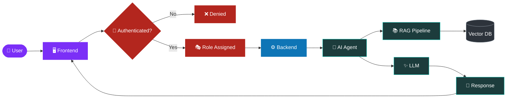

<!-- HEADER -->


<div align="center">

[](https://git.io/typing-svg)


<a href="https://github.com/parthpanchal26?tab=followers"></a>

</div>


## 👨‍💻 About Me

```js
const parth = {
  location: "India 🇮🇳",
  role: "Software Developer",
  focus: [
    "Generative AI",
    "Full Stack Development",
    "Problem Solving",
    "System Design",
  ],
  currentlyLearning: ["Generative AI", "System Design", "Design Patterns"],
  funFact: "I solve Rubik's cubes, chess puzzles, and occasionally production bugs.",
};
```


## 🧠 How I Build AI Apps




## 🛠️ Tech Stack

<div align="center">

**Languages**


**Backend & Databases**


**Generative AI**


**Tools**


</div>


## 📊 GitHub Stats

<div align="center">

<table>
  <tr>
    <td align="center">
      
    </td>
    <td align="center">
      
    </td>
  </tr>
</table>


</div>


## 🏆 Trophies

<div align="center">
  <a href="https://github.com/ryo-ma/github-profile-trophy">
    
  </a>
</div>


## 📈 Contribution Graph


## 🐍 Contribution Snake


## 🧠💡 Leetcode Stats
<div align="center">
  
</div>


## 🤝 Let's Connect

<div align="center">

<a href="https://linkedin.com/in/parthpanchal26"></a>
<a href="https://www.leetcode.com/parth_dev"></a>
<a href="mailto:parthpanchal2602@gmail.com"></a>
<a href="mailto:parth.code2625@gmail.com"></a>

<br /><br />

👀 Not many make it this far!

If you did, and you liked what you saw, let's connect! 🤝

⭐ Don't forget to follow me!
</div>


